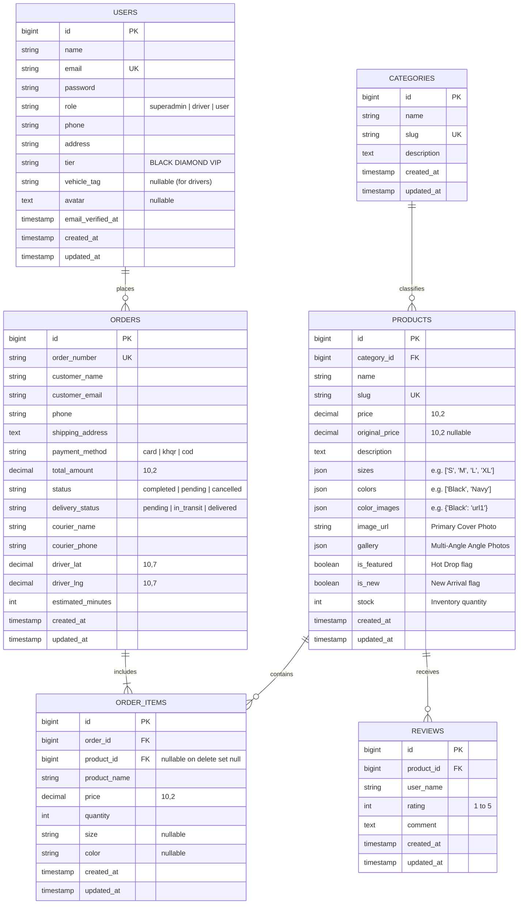

# 📋 MIDTERM PROJECT REPORT: PROJECT PLANNING & DATABASE DESIGN

**Project Title:** **LEGACY STORE (Alexandre Luxe)**  
**System Domain:** Haute Couture Luxury E-Commerce & Real-Time Logistics Tracking  
**System Architecture:** Client-Server Single Page Application (React 19 + Laravel 11 RESTful API + PostgreSQL / MySQL)  
**Academic Submission:** Midterm Project Examination & Architecture Defense  
**Date:** October 2026  

---

# SECTION 1: PROJECT PLANNING

## 1.1 Executive Summary & Problem Formulation
The modern luxury fashion market demands an uncompromising standard of digital presentation, interactive engagement, and fulfillment transparency. Conventional e-commerce systems typically offer static 2D product catalogs, detached logistics workflows, and rigid admin portals that necessitate manual developer intervention for simple marketing asset updates.

**LEGACY STORE (Alexandre Luxe)** resolves these operational bottlenecks by unifying:
1. **Interactive Merchandising:** 3D rotating cylinder community showcases, dynamic color-variant image synchronization, and interactive hover-triggered FAQ accordions.
2. **End-to-End Logistics Tracking:** Real-time driver dispatch telemetry, live GPS coordinate delivery monitoring (`driver_lat`, `driver_lng`), and SMS/phone concierge updates.
3. **Live Storefront CMS:** Cloudinary CDN asset pipeline enabling platform administrators to directly upload and publish live promotional visual assets in real time without redeployment.

---

## 1.2 System Scope & Boundaries

### 1.2.1 In-Scope Deliverables
* **Multi-Role Authentication & Access Control:**
  * Role-Based Access Control (RBAC) supporting `superadmin`, `driver`, and standard `user` (VIP patrons).
  * Secure bearer token authorization powered by Laravel Sanctum.
  * Google Verification state handling and registration workflows.
* **Product Catalog & Dynamic Merchandising:**
  * Multi-attribute filtering (category hierarchy, price boundaries, garment sizes, and color palettes).
  * Multi-photo angle gallery support and color-to-image variant mapping.
  * Detailed single-product view routes with live stock counters and customer review aggregation.
* **Cart, Checkout & Payment Infrastructure:**
  * Synchronized shopping bag state with delivery fee computation (Standard, Express, Free shipping thresholds).
  * Multi-channel checkout handling Credit Card, Bakong KHQR, and Cash on Delivery (COD).
* **Order Management & Courier Telemetry:**
  * Automatic generation of unique order tracking identifiers (`ORD-XXXXX`).
  * Live status transitions (`pending` -> `picked_up` -> `in_transit` -> `delivered`).
  * Driver telemetry showing courier identity, contact phone, and route ETA.
* **SuperAdmin Content & Media CMS:**
  * Integrated Cloudinary CDN file uploader for high-resolution photography.
  * Live homepage management for 3D cylinder carousels, vertical hero marquees, FAQs, and client impact metrics.

### 1.2.2 Out-of-Scope (Future Post-Midterm Roadmap)
* Multi-warehouse global ERP enterprise synchronization.
* Real-time automated Forex multi-currency settlement.
* WebGL / AR virtual camera fitting room simulation.

---

## 1.3 Methodology: Agile / Scrum Lifecycle

The software development process adopts the **Agile / Scrum framework**, split into **6 two-week Sprints**:

```
Sprint 1 (Weeks 1-2): Foundation, Database Architecture & RBAC Auth
Sprint 2 (Weeks 3-4): Category Hierarchies & Product Catalog Merchandising
Sprint 3 (Weeks 5-6): Shopping Cart State, Multi-Method Checkout & KHQR
Sprint 4 (Weeks 7-8): Order Lifecycle & Live Driver Courier Telemetry
Sprint 5 (Weeks 9-10): Cloudinary CDN Integration & Live Homepage CMS
Sprint 6 (Weeks 11-12): Code Quality Audit, Mobile Optimization & Midterm Verification
```

---

## 1.4 Work Breakdown Structure (WBS)

```
1.0 LEGACY STORE PLATFORM
 ├── 1.1 Requirements & System Architecture
 │    ├── 1.1.1 Stakeholder Analysis & User Personas (Shopper, Driver, SuperAdmin)
 │    ├── 1.1.2 Functional & Non-Functional Specifications
 │    └── 1.1.3 Tech Stack Selection & Development Environment Setup
 ├── 1.2 Database & Data Engineering
 │    ├── 1.2.1 Conceptual & Logical Schema Modeling
 │    ├── 1.2.2 3NF Normalization & Constraint Verification
 │    └── 1.2.3 Migration Scripts & Database Seeding (Laravel Eloquent)
 ├── 1.3 Backend API Development (Laravel 11)
 │    ├── 1.3.1 Authentication & Sanctum RBAC Middleware
 │    ├── 1.3.2 Product, Category, & Review API Endpoints
 │    ├── 1.3.3 Order Creation & Transactional Processing
 │    └── 1.3.4 Driver Telemetry & Delivery Status Endpoints
 ├── 1.4 Frontend Development (React 19 + Vite)
 │    ├── 1.4.1 Luxury Design System & Tailwind Styling
 │    ├── 1.4.2 Product Filtering, Quick View & Detail Pages
 │    ├── 1.4.3 Cart Sidebar & Multi-Payment Checkout Form
 │    └── 1.4.4 Live Delivery Tracking & Interactive Map UI
 ├── 1.5 SuperAdmin CMS & Media Integration
 │    ├── 1.5.1 Cloudinary Direct CDN Upload Service
 │    ├── 1.5.2 Product Variant Color-to-Image Mapper
 │    └── 1.5.3 Real-Time Homepage Content Synchronization
 └── 1.6 Verification & Midterm Submission
      ├── 1.6.1 Unit, Integration & API Endpoint Testing
      ├── 1.6.2 Cross-Device Mobile Responsiveness Testing
      └── 1.6.3 Midterm Documentation & Code Repository Audit
```

---

## 1.5 Sprint Milestone Schedule & Gantt View

| Milestone / Sprint | Focus Area | Primary Deliverables | Target Status |
| :--- | :--- | :--- | :---: |
| **Sprint 1 (Weeks 1-2)** | System Core & Security | DB Migrations, User Auth, Sanctum Tokens, Roles (`superadmin`, `driver`, `user`) | Completed |
| **Sprint 2 (Weeks 3-4)** | Catalog & Products | Category CRUD, Product CRUD, JSON Attributes (sizes, colors, gallery) | Completed |
| **Sprint 3 (Weeks 5-6)** | Commerce & Bag | Cart state, Multi-Step Checkout, Delivery fee calculation, Payment Gateways | Completed |
| **Sprint 4 (Weeks 7-8)** | Logistics Tracking | Delivery status pipeline, Driver GPS latitude/longitude, ETA calculations | Completed |
| **Sprint 5 (Weeks 9-10)**| Visual Merchandising | Cloudinary CDN uploads, Color variant mapper, 3D Community Carousel, FAQ CMS | Completed |
| **Sprint 6 (Weeks 11-12)**| Final Verification | Cross-platform responsiveness, Vite build validation, Academic documentation | Delivered |

---

## 1.6 Technology Stack Specification

| Component | Technology | Rationale & Justification |
| :--- | :--- | :--- |
| **Frontend Framework** | React 19 (Vite Build Tooling) | High rendering speed, ultra-fast Hot Module Replacement (HMR), component-driven UI |
| **Styling & Design** | Tailwind CSS & Ant Design | Tailored haute-couture dark aesthetics combined with enterprise-grade UI data components |
| **Backend Framework** | Laravel 11 (PHP 8.2+) | Robust MVC architecture, built-in Eloquent ORM, secure authentication and clean REST routing |
| **Database Engine** | PostgreSQL / MySQL | Relational ACID compliance, relational integrity, JSON column indexing support |
| **Cloud Storage / CDN** | Cloudinary API | Unsigned direct image CDN upload with real-time automatic image optimization |
| **Version Control** | Git / GitHub | Distributed branch versioning, automated change logs, and production release tags |

---

## 1.7 Risk Assessment & Mitigation Strategy

| Risk ID | Risk Description | Severity | Probability | Mitigation Strategy |
| :---: | :--- | :---: | :---: | :--- |
| **R-01** | Concurrent checkout inventory overselling | High | Low | Wrapped stock reductions and order creation within atomic database transactions (`DB::transaction`). |
| **R-02** | CDN image upload network failures | Medium | Medium | Implemented client-side retry handling, fallback Unsplash image presets, and base64 preview rendering. |
| **R-03** | Unauthorized privilege escalation to Admin routes | Critical | Low | Enforced strict Laravel Sanctum middleware checking `auth:sanctum` and verified `role === 'superadmin'`. |
| **R-04** | Viewport layout breakage on mobile devices | Medium | High | Mobile-first CSS architecture with collapsible drawers, responsive flex-wrap, and touch swipe gestures. |

---

# SECTION 2: DATABASE DESIGN

## 2.1 Database Architectural Principles

The relational schema is structured according to **Third Normal Form (3NF)** rules to eliminate redundancy, avoid update anomalies, and enforce relational consistency:
1. **First Normal Form (1NF):** Every table attribute holds atomic scalar values. Multi-value variants (such as garment sizes or secondary gallery URLs) are stored in dedicated JSON structures or relational line-item tables.
2. **Second Normal Form (2NF):** All non-key attributes are fully functionally dependent on the entire primary key.
3. **Third Normal Form (3NF):** No transitive dependencies exist between non-key attributes.
4. **Referential Integrity Actions:**
   * `ON DELETE CASCADE`: Used where child records cannot logically exist without their parent (e.g. deleting an order automatically cascades to its `order_items`).
   * `ON DELETE SET NULL`: Used where historical auditing must persist (e.g. if a product is decommissioned from the catalog, previous customer invoices in `order_items` preserve their transaction data while setting `product_id = NULL`).

---

## 2.2 Entity Relationship Diagram (ERD)



---

## 2.3 Detailed Data Dictionary & Schema Specifications

### Table 1: `users`
Maintains customer identity, encrypted credentials, access roles, VIP tier level, and driver fleet profiles.

| Column Name | Data Type | Nullable | Default | Constraints | Description |
| :--- | :--- | :---: | :---: | :--- | :--- |
| `id` | `BIGINT UNSIGNED` | No | Auto-Increment | `PRIMARY KEY` | Unique surrogate key |
| `name` | `VARCHAR(255)` | No | — | — | Customer / Administrator legal name |
| `email` | `VARCHAR(255)` | No | — | `UNIQUE` | User login email address |
| `email_verified_at`| `TIMESTAMP` | Yes | `NULL` | — | Timestamp of email verification |
| `password` | `VARCHAR(255)` | No | — | — | Bcrypt hashed authorization secret |
| `role` | `VARCHAR(50)` | No | `'user'` | — | Role: `'superadmin'`, `'driver'`, `'user'` |
| `phone` | `VARCHAR(50)` | Yes | `NULL` | — | Contact telephone number |
| `address` | `VARCHAR(255)` | Yes | `NULL` | — | Default billing and delivery address |
| `tier` | `VARCHAR(50)` | No | `'BLACK DIAMOND VIP'`| — | VIP membership tier |
| `vehicle_tag` | `VARCHAR(100)` | Yes | `NULL` | — | Vehicle plate tag for delivery couriers |
| `avatar` | `TEXT` | Yes | `NULL` | — | Cloudinary CDN or profile image URL |
| `remember_token` | `VARCHAR(100)` | Yes | `NULL` | — | Session continuity token |
| `created_at` | `TIMESTAMP` | Yes | `NULL` | — | Record creation timestamp |
| `updated_at` | `TIMESTAMP` | Yes | `NULL` | — | Record last modification timestamp |

---

### Table 2: `categories`
Provides product classifications for apparel, footwear, tailoring, and bespoke accessories.

| Column Name | Data Type | Nullable | Default | Constraints | Description |
| :--- | :--- | :---: | :---: | :--- | :--- |
| `id` | `BIGINT UNSIGNED` | No | Auto-Increment | `PRIMARY KEY` | Category unique key |
| `name` | `VARCHAR(255)` | No | — | — | Department title (e.g. "Footwear") |
| `slug` | `VARCHAR(255)` | No | — | `UNIQUE` | URL routing identifier (e.g. "footwear") |
| `description` | `TEXT` | Yes | `NULL` | — | Department description |
| `created_at` | `TIMESTAMP` | Yes | `NULL` | — | Record creation timestamp |
| `updated_at` | `TIMESTAMP` | Yes | `NULL` | — | Record update timestamp |

---

### Table 3: `products`
The core catalog inventory table holding pricing, image galleries, color mappings, and variant options.

| Column Name | Data Type | Nullable | Default | Constraints | Description |
| :--- | :--- | :---: | :---: | :--- | :--- |
| `id` | `BIGINT UNSIGNED` | No | Auto-Increment | `PRIMARY KEY` | Product surrogate key |
| `category_id` | `BIGINT UNSIGNED` | No | — | `FOREIGN KEY` | References `categories(id)` `ON DELETE CASCADE` |
| `name` | `VARCHAR(255)` | No | — | — | Garment name |
| `slug` | `VARCHAR(255)` | No | — | `UNIQUE` | SEO web URL identifier |
| `price` | `DECIMAL(10,2)` | No | — | — | Current selling price in USD |
| `original_price` | `DECIMAL(10,2)` | Yes | `NULL` | — | Strike-through original retail price |
| `description` | `TEXT` | Yes | `NULL` | — | Fabric composition and garment description |
| `sizes` | `JSON` | Yes | `NULL` | — | Array of sizing options: `["S", "M", "L", "XL"]` |
| `colors` | `JSON` | Yes | `NULL` | — | Array of colors: `["Black", "White", "Red"]` |
| `color_images` | `JSON` | Yes | `NULL` | — | Mapping of color to image: `{"Red": "url"}` |
| `image_url` | `VARCHAR(500)` | No | — | — | Primary cover photo URL |
| `gallery` | `JSON` | Yes | `NULL` | — | Array of secondary multi-angle photo URLs |
| `is_featured` | `BOOLEAN` | No | `false` | — | "Hot Drop" promotional toggle |
| `is_new` | `BOOLEAN` | No | `false` | — | "New Arrival" merchandising badge |
| `stock` | `INTEGER` | No | `50` | — | Current warehouse quantity on hand |
| `created_at` | `TIMESTAMP` | Yes | `NULL` | — | Record creation timestamp |
| `updated_at` | `TIMESTAMP` | Yes | `NULL` | — | Record update timestamp |

---

### Table 4: `orders`
Stores completed client transactions, payment channels, delivery statuses, and driver GPS coordinates.

| Column Name | Data Type | Nullable | Default | Constraints | Description |
| :--- | :--- | :---: | :---: | :--- | :--- |
| `id` | `BIGINT UNSIGNED` | No | Auto-Increment | `PRIMARY KEY` | Order primary key |
| `order_number` | `VARCHAR(255)` | No | — | `UNIQUE` | Customer-facing order code (`ORD-XXXXX`) |
| `customer_name` | `VARCHAR(255)` | No | — | — | Recipient full name |
| `customer_email`| `VARCHAR(255)` | No | — | — | Notification and receipt email |
| `phone` | `VARCHAR(50)` | No | — | — | Express dispatch telephone |
| `shipping_address`| `TEXT` | No | — | — | Destination delivery address |
| `payment_method`| `VARCHAR(50)` | No | `'card'` | — | Channel: `'card'`, `'khqr'`, `'cod'` |
| `total_amount` | `DECIMAL(10,2)` | No | — | — | Final gross amount billed |
| `status` | `VARCHAR(50)` | No | `'completed'`| — | Order state (`'pending'`, `'completed'`) |
| `delivery_status`| `VARCHAR(50)` | No | `'pending'` | — | Fulfillment: `'pending'`, `'in_transit'`, `'delivered'` |
| `courier_name` | `VARCHAR(255)` | Yes | `'Sokha Express'` | — | Assigned courier full name |
| `courier_phone` | `VARCHAR(50)` | Yes | `'+855 12 888 999'`| — | Driver contact telephone |
| `driver_lat` | `DECIMAL(10,7)` | Yes | `11.5564` | — | Current GPS latitude of driver |
| `driver_lng` | `DECIMAL(10,7)` | Yes | `104.9282` | — | Current GPS longitude of driver |
| `estimated_minutes`| `INTEGER` | Yes | `25` | — | Estimated delivery arrival time (minutes) |
| `created_at` | `TIMESTAMP` | Yes | `NULL` | — | Order placement timestamp |
| `updated_at` | `TIMESTAMP` | Yes | `NULL` | — | Order update timestamp |

---

### Table 5: `order_items`
Records individual purchased items, preserving historical price and variant selections at time of purchase.

| Column Name | Data Type | Nullable | Default | Constraints | Description |
| :--- | :--- | :---: | :---: | :--- | :--- |
| `id` | `BIGINT UNSIGNED` | No | Auto-Increment | `PRIMARY KEY` | Line item primary key |
| `order_id` | `BIGINT UNSIGNED` | No | — | `FOREIGN KEY` | References `orders(id)` `ON DELETE CASCADE` |
| `product_id` | `BIGINT UNSIGNED` | Yes | `NULL` | `FOREIGN KEY` | References `products(id)` `ON DELETE SET NULL` |
| `product_name` | `VARCHAR(255)` | No | — | — | Frozen snapshot of item title |
| `price` | `DECIMAL(10,2)` | No | — | — | Frozen price at sale date |
| `quantity` | `INTEGER` | No | — | — | Quantity of units purchased |
| `size` | `VARCHAR(50)` | Yes | `NULL` | — | Selected size option (e.g. `'L'`) |
| `color` | `VARCHAR(50)` | Yes | `NULL` | — | Selected color option (e.g. `'Black'`) |
| `created_at` | `TIMESTAMP` | Yes | `NULL` | — | Line item creation timestamp |
| `updated_at` | `TIMESTAMP` | Yes | `NULL` | — | Line item update timestamp |

---

### Table 6: `reviews`
Stores client star ratings and feedback for purchased garments.

| Column Name | Data Type | Nullable | Default | Constraints | Description |
| :--- | :--- | :---: | :---: | :--- | :--- |
| `id` | `BIGINT UNSIGNED` | No | Auto-Increment | `PRIMARY KEY` | Review surrogate key |
| `product_id` | `BIGINT UNSIGNED` | No | — | `FOREIGN KEY` | References `products(id)` `ON DELETE CASCADE` |
| `user_name` | `VARCHAR(255)` | No | — | — | Reviewer display name |
| `rating` | `INTEGER` | No | `5` | `CHECK (1..5)` | Score between 1 and 5 stars |
| `comment` | `TEXT` | Yes | `NULL` | — | Customer feedback commentary |
| `created_at` | `TIMESTAMP` | Yes | `NULL` | — | Review timestamp |
| `updated_at` | `TIMESTAMP` | Yes | `NULL` | — | Review update timestamp |

---

## 2.4 Indexing & Query Optimization

```sql
-- Uniqueness & Primary Lookups
CREATE UNIQUE INDEX idx_categories_slug ON categories(slug);
CREATE UNIQUE INDEX idx_products_slug ON products(slug);
CREATE UNIQUE INDEX idx_users_email ON users(email);
CREATE UNIQUE INDEX idx_orders_number ON orders(order_number);

-- Relational Foreign Key Accelerators
CREATE INDEX idx_products_category_id ON products(category_id);
CREATE INDEX idx_products_price ON products(price);
CREATE INDEX idx_order_items_order_id ON order_items(order_id);
CREATE INDEX idx_reviews_product_id ON reviews(product_id);

-- Operational Dispatch Queries
CREATE INDEX idx_orders_delivery_status ON orders(delivery_status);
CREATE INDEX idx_orders_created_at ON orders(created_at DESC);
```

---

## 2.5 Transactional Integrity & ACID Implementation

* **Atomicity:** When an order is placed, `DB::transaction()` guarantees that:
  1. The `orders` record is created.
  2. Each line item is saved into `order_items`.
  3. Product warehouse stock (`stock`) is decremented.
  If any step fails, the entire transaction rolls back automatically.
* **Consistency & Isolation:** Foreign key constraints prevent orphaned records. Standard Read Committed transaction isolation protects against dirty reads during simultaneous checkouts.
* **Durability:** Committed transactions are flushed immediately to persistent disk storage in PostgreSQL / MySQL write-ahead logs (WAL).
